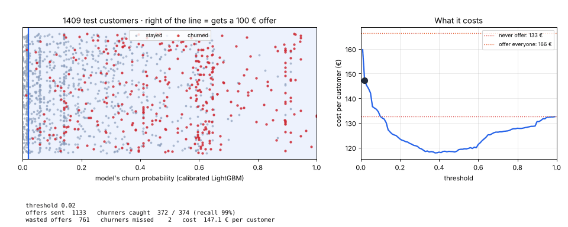
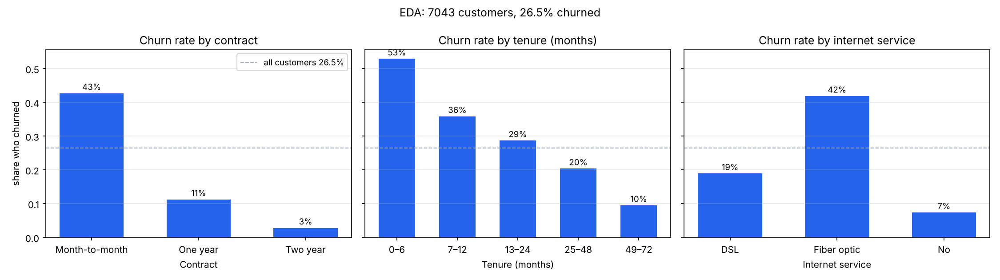
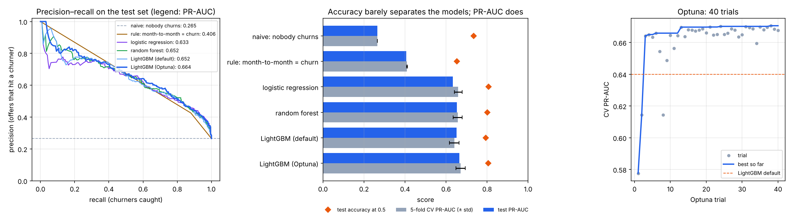
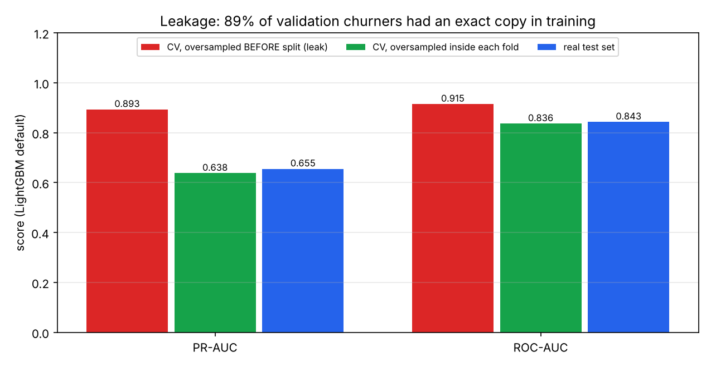
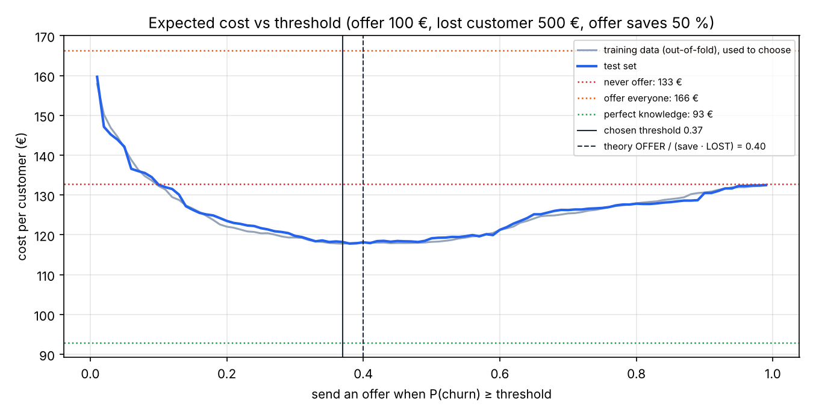
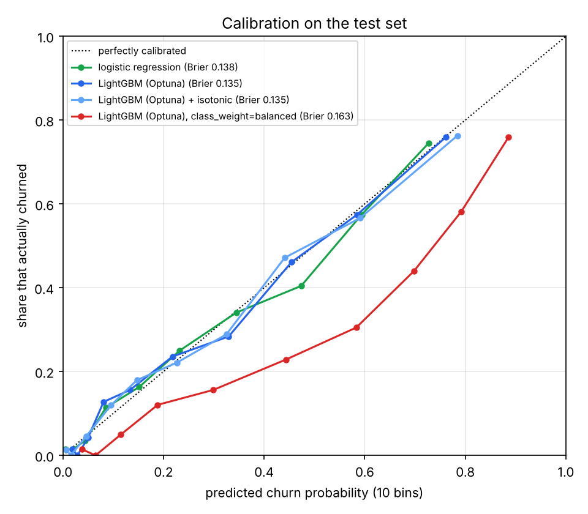
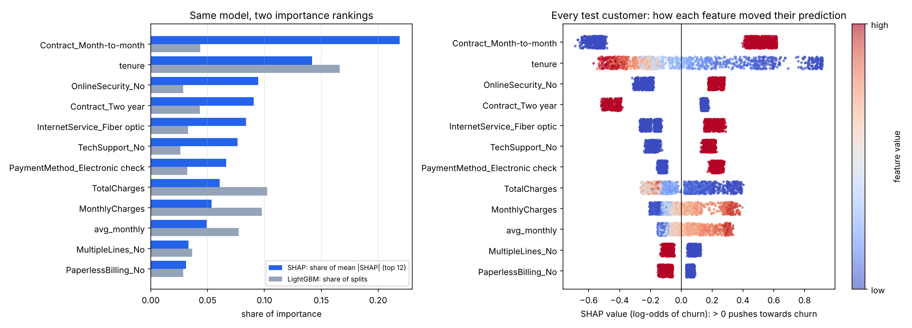

# 07 · Tabular ML end-to-end: customer churn (P2)

🇸🇰 [Slovenská verzia](README.sk.md) · 📘 [Step-by-step tutorial](TUTORIAL.md)

## TL;DR
Predict which telecom customers will cancel, then decide who gets a retention offer. IBM Telco Customer Churn, 7043 customers, 26.5 % churned. Every number below comes from `results.json` (one stratified 80/20 split, seed 42, cloud Linux CPU).

- **Best model:** LightGBM tuned with Optuna. Test **PR-AUC 0.664**, against **0.265** for the naive baseline and 0.633 for logistic regression. All four learned models land within 0.03 of each other.
- **Accuracy lies here too.** "Nobody churns" is 73.5 % accurate, and the best model reaches only 80.5 %.
- **Leakage found:** oversampling churners *before* the CV split pushes CV PR-AUC to **0.893**. Done correctly (inside each fold) it is **0.638**, and the real test set says 0.655. 89 % of validation churners had an exact copy in the training fold.
- **Threshold from a cost matrix** (offer 100 €, lost customer 500 €, an offer saves 50 %):
  - The threshold is chosen on training data only: **0.37**. Theory gives 0.40.
  - On the test set it catches **68 % of churners** (255 / 374), and 59 % of offers hit a real churner.
  - Cost is **118.2 € per customer**, vs 132.7 € for "never offer" and 166.4 € for "offer everyone".
- **Calibration:** LightGBM's probabilities are already calibrated (Brier 0.135). `class_weight="balanced"` breaks them: mean predicted 41 % vs a true 27 %, which costs 124.1 €.
- **Served by FastAPI.** All 1409 test customers through `POST /predict` match the offline predictions exactly (max difference 0.0). A typo returns 422.



## Start here
A telecom company wants to know **which customers may leave** so it can offer them a discount in time. But an offer costs €100, so sending one to everyone is expensive. The input is a table of customer facts, such as contract length, monthly charge, and services used. The output is a churn probability and a decision about whom to contact.

The project first sets customers aside for independent evaluation. On the remaining data it compares a simple rule, logistic regression, and stronger models. A `Pipeline` handles missing values and text categories so information from the evaluation fold cannot leak into training. Then it chooses a model and a **threshold**: the probability above which an offer is worthwhile. Under the stated cost assumptions, the selected policy costs €118.2 per customer versus €132.7 if no one receives an offer.

It also demonstrates a deliberate mistake: copying churners before splitting the data makes the model appear far better during validation than it really is. This is **data leakage**. The plot shows how cost changes with the threshold; the API at the end lets a client ask for one customer's prediction.

## Problem
A telecom company loses about a quarter of its customers. A retention offer (a discount) costs money, so you can't give it to everyone. The goal from the roadmap: build the full tabular workflow (EDA → baseline → logistic regression → `Pipeline` + `ColumnTransformer` → stratified CV → LightGBM → Optuna → threshold from business costs → calibration → SHAP → FastAPI), and find and document at least one leakage. It is the same kind of problem as members leaving a gym, which is why it is on the roadmap.

**Metric:** PR-AUC (average precision), because step 06 showed that ROC-AUC and accuracy hide what happens to the minority class. The final decision is judged in **€ per customer**, because that is what the business pays.

## Setup
- Data: [IBM Telco Customer Churn](https://github.com/IBM/telco-customer-churn-on-icp4d), the same CSV as on Kaggle. `data.py` downloads it to `data/`, which is not committed.
- 19 raw columns (contract, tenure, services, charges, payment method …) plus 3 engineered: number of services, average past monthly charge, and the difference between today's charge and that average.
- Split: 80 % train (5634) / 20 % test (1409, 374 churners), stratified. All model choices (hyperparameters, threshold) use 5-fold stratified CV on the training part only. The test set is touched once per model.
- Libraries: scikit-learn, LightGBM, Optuna (40 trials), SHAP, FastAPI. Measured on a cloud Linux CPU (4 cores), not the Mac. A full `churn.py` run takes 108 s there.

## How it works

### 1. EDA (`eda` in `churn.py`)


Three columns already tell most of the story:
- **Contract:** 43 % of month-to-month customers churn, vs 11 % on one-year and 3 % on two-year contracts.
- **Tenure:** 53 % of customers in their first 6 months leave, but only 10 % after 4 years.
- **Internet:** fiber customers churn at 42 %, DSL at 19 %.

11 brand-new customers (tenure 0) have an empty `TotalCharges`. They haven't been billed yet, so it becomes NaN and the imputer fills it.

### 2. Two baselines
- **Naive:** everybody gets the training churn rate. It ranks nobody above anybody, so its PR-AUC equals the share of churners (0.265). That is the floor.
- **Rule:** "month-to-month contract = will churn", what a human would write first. PR-AUC 0.406. To beat it a model has to use more than the contract.

### 3. `Pipeline` + `ColumnTransformer`
```python
ColumnTransformer([("num", make_pipeline(SimpleImputer(strategy="median"), StandardScaler()), NUMERIC),
                   ("cat", OneHotEncoder(handle_unknown="ignore"), CATEGORICAL)])
Pipeline([("prep", preprocess()), ("model", model)])
```
**Why a pipeline:** the median, the scaling and the list of categories are part of the model. If you compute them on the whole dataset before splitting, the validation fold has already influenced training: a small leak. Inside a `Pipeline`, every CV fold refits them on its own training part. `handle_unknown="ignore"` means a category never seen in training becomes all zeros instead of crashing the API.

### 4. Models, stratified CV and Optuna
Stratified 5-fold CV keeps 26.5 % churners in every fold, so fold scores are comparable. Optuna then searches LightGBM's hyperparameters (trees, learning rate, leaves, regularisation …) to maximise mean CV PR-AUC. It found very small trees (4 leaves), 550 of them, a low learning rate (0.019) and strong L2 regularisation (25.5). That is a sign the data has little complex structure to find.



### 5. Leakage: oversampling before the split (`leakage`)
A popular "fix" for imbalance is to copy churners until both classes are equal size. If you do it **before** cross-validation, copies of the same customer land in both the training fold and the validation fold. The model then gets tested on rows it has already memorised.



| LightGBM (default) | PR-AUC | ROC-AUC |
|---|---|---|
| CV, oversampled **before** the split (leak) | **0.893** | **0.915** |
| CV, oversampled inside each training fold | 0.638 | 0.836 |
| Real test set (model trained on oversampled train) | 0.655 | 0.843 |

89 % of the churners in the leaky validation folds had an exact copy in the training fold. ROC-AUC is inflated too, even though it doesn't care about class balance, so this is memorisation, not just a different base rate. Oversampling done correctly doesn't help either: 0.638 vs 0.640 without it.

### 6. Threshold from a cost matrix (`best_threshold`)
| | customer stays | customer would churn |
|---|---|---|
| **send offer** | 100 € (wasted) | 100 € + 50 % × 500 € still lost = 350 € |
| **no offer** | 0 € | 500 € |

Send the offer when it is cheaper than doing nothing: `100 + p · 250 < p · 500`, so **p > 0.40**. That only holds if `p` is a real probability (see calibration). In practice I pick the threshold that minimises cost on **out-of-fold predictions of the training set**, never on the test set. That gave **0.37**.



The cost curve is flat between about 0.3 and 0.5, so the exact threshold matters less than not using an extreme one. Moving from the default 0.5 to 0.37 catches 62 more churners (255 vs 193). The cost barely changes (118.2 € vs 119.1 €), because each extra churner caught comes with extra wasted offers.

### 7. Calibration
A model is calibrated when "30 % risk" really means 30 of 100 such customers leave.



| Model | Brier ↓ | Mean predicted (true 0.265) | Offers at theory threshold 0.40 | Cost |
|---|---|---|---|---|
| logistic regression | 0.138 | 0.268 | 441 | 119.7 € |
| LightGBM (Optuna) | 0.135 | 0.266 | 420 | 118.0 € |
| LightGBM (Optuna) + isotonic | 0.135 | 0.267 | 402 | 118.1 € |
| LightGBM (Optuna), `class_weight="balanced"` | 0.163 | **0.411** | **674** | **124.1 €** |

Log-loss-trained models (logistic regression, LightGBM) are already close to the diagonal, so isotonic calibration changes nothing here. `class_weight="balanced"`, the other popular imbalance trick, weights each churner about 2.8× more than a staying customer. Every probability goes up, the 0.40 rule sends 674 offers, and the cost rises. **Rebalance the data and you must re-choose the threshold; better, don't rebalance and choose the threshold from costs.** The final model keeps the isotonic step anyway, as a guard if the data changes.

### 8. SHAP vs built-in feature importance (`explain`)


- **LightGBM's split count** ranks `tenure`, `TotalCharges`, `MonthlyCharges` and my engineered `charge_change` at the top. Continuous columns offer many possible split points, so trees split on them often, even for tiny gains.
- **SHAP** measures how much each feature actually moves each prediction. Its ranking: month-to-month contract (22 % of the |SHAP| total over the top 12 features), tenure, no online security, two-year contract, fiber internet.
- The beeswarm also shows the *direction*: a short tenure (blue) pushes towards churn, a long one away from it.
- For the riskiest test customer (P = 0.90), the biggest pushes are 1 month of tenure (+0.76 log-odds) and a month-to-month contract (+0.59).

### 9. FastAPI (`app.py`)
`POST /predict` takes one customer as JSON. It returns the churn probability, `send_offer` (true or false at the chosen threshold) and a short reason in €. `Literal` types in the pydantic model reject a typo like `"Contract": "monthly"` with HTTP 422 instead of returning a silent wrong answer. `api_check.py` sends all 1409 test customers through the endpoint and compares them with `churn.py`: maximum difference 0.0. Median latency was 74 ms per request (in-process test client, cloud CPU). Most of it is the 5 LightGBM models inside the isotonic calibrator plus pandas overhead.

## Results
| Model | CV PR-AUC (5-fold) | Test PR-AUC | Test ROC-AUC | Accuracy at 0.5 | Cost threshold* | Recall | Precision | Cost / customer |
|---|---|---|---|---|---|---|---|---|
| naive: nobody churns | 0.265 ± 0.000 | 0.265 | 0.500 | 73.5 % | – | 0.0 % | – | 132.7 € |
| rule: month-to-month = churn | 0.409 ± 0.002 | 0.406 | 0.725 | 65.3 % | (all M-t-M) | 88.0 % | 42.6 % | 129.2 € |
| logistic regression | 0.659 ± 0.019 | 0.633 | 0.842 | 80.8 % | 0.46 | 60.4 % | 61.2 % | 118.8 € |
| random forest | 0.656 ± 0.022 | 0.652 | 0.842 | 80.1 % | 0.41 | 61.2 % | 58.4 % | 119.9 € |
| LightGBM (default) | 0.640 ± 0.023 | 0.652 | 0.839 | 79.3 % | 0.43 | 60.4 % | 59.8 % | 119.4 € |
| **LightGBM (Optuna)** | **0.671 ± 0.022** | **0.664** | **0.847** | 80.5 % | 0.36 | **70.6 %** | 58.1 % | **118.1 €** |
| final: LightGBM (Optuna) + isotonic | – | 0.663 | 0.848 | – | 0.37 | 68.2 % | 58.9 % | 118.2 € |

\* Chosen on out-of-fold predictions of the training set. Reference policies on the test set: never offer 132.7 €, offer everyone 166.4 €, perfect knowledge 92.9 €.

## Error analysis
- **The models agree more than they differ.** Test PR-AUC spans 0.633–0.664 and the CV standard deviation is about 0.02, so most of the gaps are inside the noise (step 06: a 1409-row test set is a noisy ruler). Only "learned model vs baselines" is a clear win. "LightGBM beats logistic regression" is a weak result here.
- **Why boosting barely wins:** the signal is mostly a few strong, nearly additive effects (contract, tenure, internet type). That is exactly what logistic regression can express. Optuna confirms it by choosing 4-leaf trees.
- **Who it misses:** 119 of 374 churners got no offer. The caught ones are almost all month-to-month (99.6 %), with a median tenure of 4 months and 80 % on fiber. The missed ones look like loyal customers: median tenure 28 months, 37 % on one- or two-year contracts, 41 % on fiber. Nothing in these columns says they are about to leave. A move, a competitor's offer or complaints would be needed, and they are not in the data.
- **The savings are modest:** the best policy saves 14.5 € per customer vs doing nothing. A perfect model would save 39.8 €. The model closes 36 % of that gap.

## Visual example: why not the cars
Churn is a table of customers and a business decision in €, and the cars have neither, so I did not force a Racing Lab chapter. The GIF at the top fits better. Each dot is one test customer, placed by predicted churn probability (red = really churned). The line is the threshold sliding across them, and on the right the cost moves with it until it stops at the threshold chosen from training data. Code: `threshold_gif.py`.

## What I learned
- First build a naive baseline and a human rule; a model is only interesting if it beats both. Here every learned model does, by a similar margin.
- Leakage looks like a great result. 0.89 CV PR-AUC from a model that really scores 0.64 is the kind of number that should make you suspicious, not happy.
- Everything fitted to data (imputer, scaler, encoder, oversampling) belongs inside the CV fold, which is what `Pipeline` is for.
- The threshold is a business decision, not 0.5. With calibrated probabilities you can even derive it: offer cost / (save rate × value of a customer).
- Rebalancing tricks (oversampling, `class_weight`) don't add information. They shift probabilities, and then a cost-based threshold is wrong.
- Split-count importance favours continuous columns; SHAP answers "how much did this feature change this prediction?".
- On a small, clean table with additive signal, gradient boosting wins by a hair; deep learning would not be worth it.

## Run it
```bash
uv sync                          # on a Mac LightGBM also needs: brew install libomp
uv run python data.py            # download the CSV to data/
uv run python churn.py           # all experiments → results.json, models/churn_model.joblib (~2 min)
uv run python plot.py            # assets/*.png
uv run python threshold_gif.py   # assets/threshold.gif
uv run python api_check.py       # all test customers through the API → results_api.json
uv run uvicorn app:app --reload  # then: curl -X POST localhost:8000/predict -H 'Content-Type: application/json' -d @example_customer.json
```

## Limitations
- One dataset and one 80/20 split. Differences under ~0.02 PR-AUC between models are not reliable.
- The cost matrix is my assumption (100 € offer, 500 € lost customer, 50 % of offers work). In reality the save rate differs between customers and should be measured with an A/B test (uplift modelling).
- The dataset is a snapshot with no time order, so "predict next month from last month" (the hardest leakage to catch: features recorded after the churn) can't be tested here.
- Measured on a cloud Linux CPU, not the Mac. Latency is in-process, without network.
- Stretch not done yet: logistic regression and a decision tree from scratch in NumPy.
