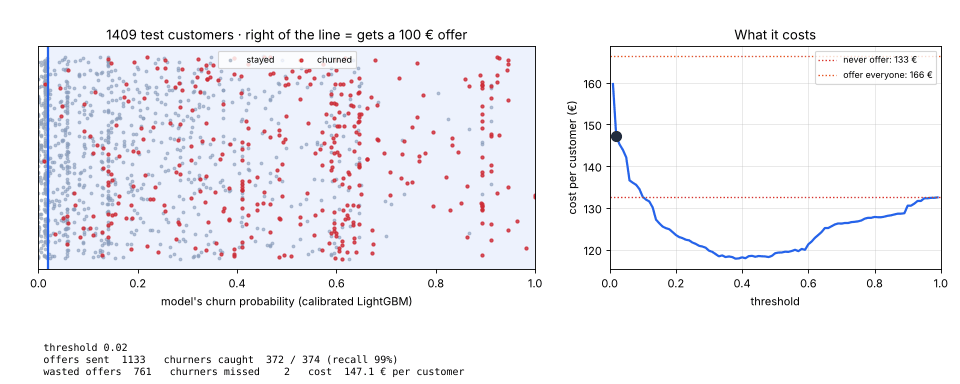
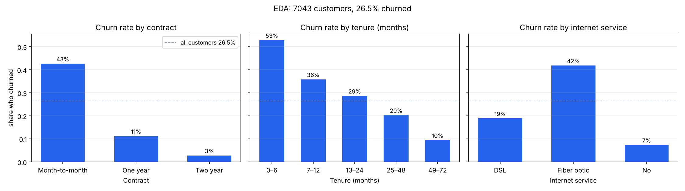
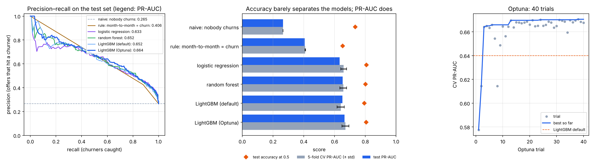
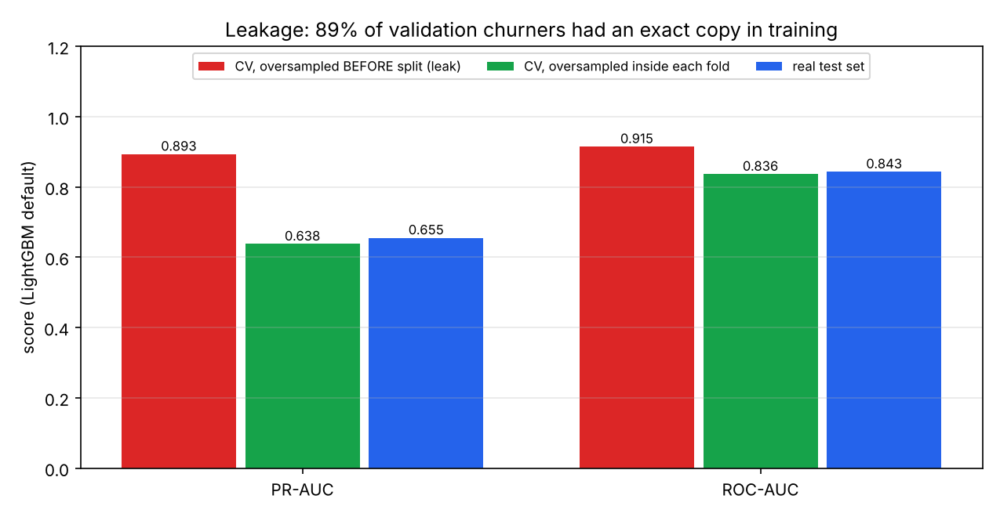
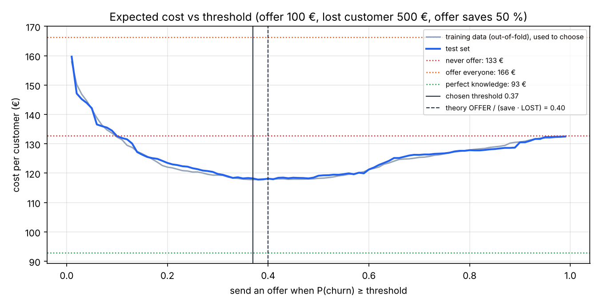
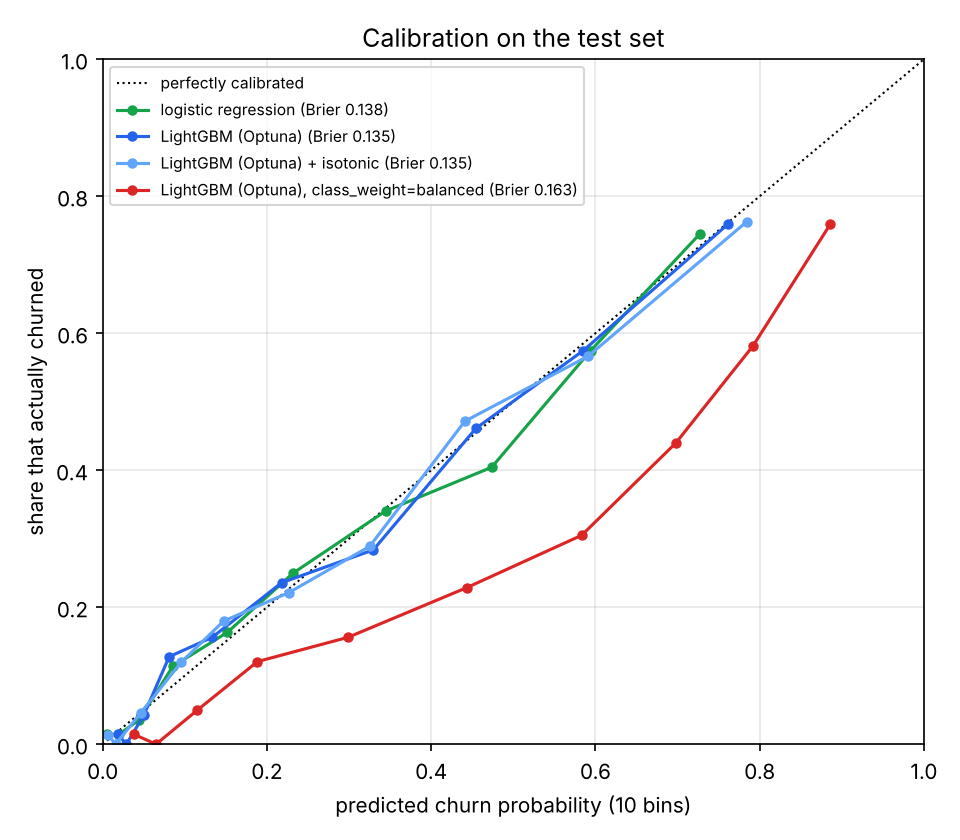
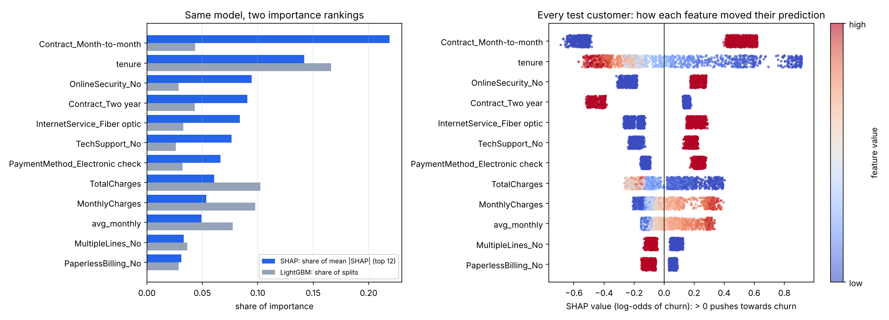

# 07 · Tabulárne ML end-to-end: odchod zákazníkov (P2)

🇬🇧 [English version](README.md)

## TL;DR
Predpovedať, ktorí zákazníci telekomunikačnej firmy zrušia zmluvu, a rozhodnúť, kto dostane ponuku na udržanie. Dataset IBM Telco Customer Churn: 7043 zákazníkov, 26,5 % odišlo. Každé číslo nižšie pochádza z `results.json` (jedno stratifikované rozdelenie 80/20, seed 42, cloudové Linux CPU).

- **Najlepší model:** LightGBM vyladený cez Optunu. Test **PR-AUC 0,664**, oproti **0,265** pre naivný baseline a 0,633 pre logistickú regresiu. Všetky štyri naučené modely sú od seba do 0,03.
- **Presnosť (accuracy) klame aj tu.** „Nikto neodíde“ má presnosť 73,5 % a najlepší model len 80,5 %.
- **Nájdený leakage:** oversampling odchádzajúcich zákazníkov *pred* rozdelením na CV foldy vyhodí CV PR-AUC na **0,893**. Pri správnom postupe (vnútri každého foldu) je to **0,638** a skutočný test set hovorí 0,655. 89 % odchádzajúcich vo validačnom folde malo presnú kópiu v trénovacom folde.
- **Prah z cost matice** (ponuka 100 €, stratený zákazník 500 €, ponuka udrží 50 %):
  - Prah je zvolený len na trénovacích dátach: **0,37**. Teória dáva 0,40.
  - Na test sete zachytí **68 % odchádzajúcich** (255 / 374) a 59 % ponúk trafí naozaj odchádzajúceho.
  - Náklad je **118,2 € na zákazníka**, oproti 132,7 € pre „nikdy neponúkni“ a 166,4 € pre „ponúkni všetkým“.
- **Kalibrácia:** pravdepodobnosti LightGBM sú už kalibrované (Brier 0,135). `class_weight="balanced"` ich pokazí: priemerná predikcia 41 % namiesto skutočných 27 %, čo stojí 124,1 €.
- **Beží za FastAPI.** Všetkých 1409 testovacích zákazníkov cez `POST /predict` sa presne zhoduje s offline predikciami (max. rozdiel 0,0). Preklep vráti 422.



## Najprv jednoducho
Telekomunikačná firma chce vedieť, **komu hrozí odchod**, aby mu mohla včas ponúknuť zľavu. Zľava však stojí 100 € a netreba ju dávať každému. Vstupom sú tabuľkové údaje o zákazníkoch, napríklad dĺžka zmluvy, mesačný poplatok a používané služby. Výstupom je pravdepodobnosť odchodu a rozhodnutie, komu poslať ponuku.

Projekt najprv vyhradí časť zákazníkov na nezávislé hodnotenie. Na ostatných porovná jednoduché pravidlo, logistickú regresiu a výkonnejšie modely. Chýbajúce hodnoty a textové kategórie spracuje v jednom `Pipeline`, aby informácie z hodnotiacej časti nepresiakli do tréningu. Potom vyberie model a **prah**: hranicu pravdepodobnosti, nad ktorou sa ponuka oplatí. Pri daných predpokladoch stojí zvolená stratégia 118,2 € na zákazníka oproti 132,7 €, keby firma neposlala ponuku nikomu.

Zámerne ukáže aj chybu v postupe: ak sa odchádzajúci zákazníci skopírujú ešte pred rozdelením dát, model vyzerá pri kontrole oveľa lepšie, než je v skutočnosti. Toto sa volá **únik dát**. Graf ukazuje, ako sa náklady menia podľa zvoleného prahu; API na konci umožní položiť modelu otázku pre jedného zákazníka.

## Problém
Telekomunikačná firma stráca zhruba štvrtinu zákazníkov. Ponuka na udržanie (zľava) stojí peniaze, takže ju nemôžeš dať každému. Cieľ podľa roadmapy: postaviť celý tabulárny postup (EDA → baseline → logistická regresia → `Pipeline` + `ColumnTransformer` → stratified CV → LightGBM → Optuna → prah podľa biznis nákladov → kalibrácia → SHAP → FastAPI) a nájsť a zdokumentovať aspoň jeden leakage. Je to rovnaký typ problému ako odchod členov fitka, preto je v roadmape.

**Metrika:** PR-AUC (average precision), lebo krok 06 ukázal, že ROC-AUC a presnosť skrývajú, čo sa deje s menšinovou triedou. Konečné rozhodnutie sa hodnotí v **€ na zákazníka**, lebo to firma platí.

## Setup
- Dáta: [IBM Telco Customer Churn](https://github.com/IBM/telco-customer-churn-on-icp4d), ten istý CSV ako na Kaggle. `data.py` ho stiahne do `data/`, ktoré sa necommituje.
- 19 surových stĺpcov (zmluva, doba zákazníka, služby, poplatky, spôsob platby …) plus 3 odvodené: počet služieb, priemerný minulý mesačný poplatok a rozdiel medzi dnešným poplatkom a týmto priemerom.
- Rozdelenie: 80 % tréning (5634) / 20 % test (1409, z toho 374 odchádzajúcich), stratifikované. Všetky voľby modelu (hyperparametre, prah) používajú 5-fold stratified CV len na trénovacej časti. Test set sa použije raz na model.
- Knižnice: scikit-learn, LightGBM, Optuna (40 pokusov), SHAP, FastAPI. Merané na cloudovom Linux CPU (4 jadrá), nie na Macu. Celý beh `churn.py` tam trvá 108 s.

## Ako to funguje

### 1. EDA (`eda` v `churn.py`)


Tri stĺpce povedia väčšinu príbehu:
- **Zmluva:** odíde 43 % zákazníkov s mesačnou zmluvou, oproti 11 % pri ročnej a 3 % pri dvojročnej.
- **Doba zákazníka:** odíde 53 % zákazníkov v prvých 6 mesiacoch, ale len 10 % po 4 rokoch.
- **Internet:** zákazníci s optikou odchádzajú v 42 %, s DSL v 19 %.

11 úplne nových zákazníkov (tenure 0) má prázdne `TotalCharges`. Ešte im nebolo nič fakturované, takže z toho je NaN a doplní ho imputer.

### 2. Dva baselines
- **Naivný:** každý dostane trénovaciu mieru odchodu. Nikoho nezoradí nad nikoho, takže jeho PR-AUC sa rovná podielu odchádzajúcich (0,265). To je dno.
- **Pravidlo:** „mesačná zmluva = odíde“, čo by človek napísal ako prvé. PR-AUC 0,406. Aby ho model porazil, musí použiť viac než zmluvu.

### 3. `Pipeline` + `ColumnTransformer`
```python
ColumnTransformer([("num", make_pipeline(SimpleImputer(strategy="median"), StandardScaler()), NUMERIC),
                   ("cat", OneHotEncoder(handle_unknown="ignore"), CATEGORICAL)])
Pipeline([("prep", preprocess()), ("model", model)])
```
**Prečo pipeline:** medián, škálovanie a zoznam kategórií sú súčasťou modelu. Ak ich spočítaš na celom datasete pred rozdelením, validačný fold už ovplyvnil tréning: malý leak. Vnútri `Pipeline` si ich každý CV fold nafituje znova na svojej trénovacej časti. `handle_unknown="ignore"` znamená, že kategória, ktorú tréning nevidel, sa zmení na samé nuly namiesto pádu API.

### 4. Modely, stratified CV a Optuna
Stratifikované 5-fold CV drží 26,5 % odchádzajúcich v každom folde, takže skóre foldov sú porovnateľné. Optuna potom hľadá hyperparametre LightGBM (počet stromov, learning rate, listy, regularizácia …) tak, aby maximalizovala priemerné CV PR-AUC. Našla veľmi malé stromy (4 listy), 550 kusov, nízky learning rate (0,019) a silnú L2 regularizáciu (25,5). To je znak, že v dátach nie je veľa zložitej štruktúry na nájdenie.



### 5. Leakage: oversampling pred rozdelením (`leakage`)
Populárna „oprava“ nevyváženosti je kopírovať odchádzajúcich, kým nie sú obe triedy rovnako veľké. Ak to urobíš **pred** krížovou validáciou, kópie toho istého zákazníka skončia v trénovacom aj validačnom folde. Model sa potom testuje na riadkoch, ktoré si už zapamätal.



| LightGBM (default) | PR-AUC | ROC-AUC |
|---|---|---|
| CV, oversampling **pred** rozdelením (leak) | **0,893** | **0,915** |
| CV, oversampling vnútri každého trénovacieho foldu | 0,638 | 0,836 |
| Skutočný test set (model trénovaný na oversamplovanom tréningu) | 0,655 | 0,843 |

89 % odchádzajúcich v deravých validačných foldoch malo presnú kópiu v trénovacom folde. Nafúknuté je aj ROC-AUC, hoci mu na pomere tried nezáleží, takže je to zapamätanie, nie len iná základná početnosť. Správne urobený oversampling tiež nepomôže: 0,638 oproti 0,640 bez neho.

### 6. Prah z cost matice (`best_threshold`)
| | zákazník zostane | zákazník by odišiel |
|---|---|---|
| **pošli ponuku** | 100 € (zbytočne) | 100 € + 50 % × 500 € aj tak stratené = 350 € |
| **bez ponuky** | 0 € | 500 € |

Ponuku pošli, keď je lacnejšia než nerobiť nič: `100 + p · 250 < p · 500`, teda **p > 0,40**. Platí to len vtedy, keď je `p` skutočná pravdepodobnosť (pozri kalibráciu). V praxi vyberiem prah, ktorý minimalizuje náklady na **out-of-fold predikciách trénovacej sady**, nikdy nie na test sete. Vyšlo **0,37**.



Krivka nákladov je medzi zhruba 0,3 a 0,5 plochá, takže na presnom prahu záleží menej ako na tom, aby nebol extrémny. Posun z defaultných 0,5 na 0,37 zachytí o 62 odchádzajúcich viac (255 vs 193). Náklad sa takmer nezmení (118,2 € vs 119,1 €), lebo s každým navyše zachyteným prídu aj zbytočné ponuky navyše.

### 7. Kalibrácia
Model je kalibrovaný, keď „30 % riziko“ naozaj znamená, že zo 100 takých zákazníkov odíde 30.



| Model | Brier ↓ | Priemerná predikcia (skutočnosť 0,265) | Ponúk pri teoretickom prahu 0,40 | Náklad |
|---|---|---|---|---|
| logistická regresia | 0,138 | 0,268 | 441 | 119,7 € |
| LightGBM (Optuna) | 0,135 | 0,266 | 420 | 118,0 € |
| LightGBM (Optuna) + isotonic | 0,135 | 0,267 | 402 | 118,1 € |
| LightGBM (Optuna), `class_weight="balanced"` | 0,163 | **0,411** | **674** | **124,1 €** |

Modely trénované na log-loss (logistická regresia, LightGBM) sú už blízko diagonály, takže izotonická kalibrácia tu nič nezmení. `class_weight="balanced"`, druhý populárny trik na nevyváženosť, váži každého odchádzajúceho asi 2,8× viac než zostávajúceho. Všetky pravdepodobnosti stúpnu, pravidlo 0,40 pošle 674 ponúk a náklad vzrastie. **Ak prevážiš dáta, musíš prah zvoliť znova; lepšie je neprevažovať a prah zvoliť z nákladov.** Finálny model si izotonický krok aj tak nechá ako poistku, keby sa dáta zmenili.

### 8. SHAP vs vstavaná dôležitosť príznakov (`explain`)


- **Počet splitov v LightGBM** dá navrch `tenure`, `TotalCharges`, `MonthlyCharges` a môj odvodený `charge_change`. Spojité stĺpce ponúkajú veľa možných deliacich bodov, takže stromy podľa nich delia často, aj pre drobné zisky.
- **SHAP** meria, o koľko každý príznak naozaj posunie každú predikciu. Jeho poradie: mesačná zmluva (22 % súčtu |SHAP| cez 12 najdôležitejších príznakov), doba zákazníka, bez online zabezpečenia, dvojročná zmluva, optický internet.
- Beeswarm ukazuje aj *smer*: krátka doba zákazníka (modrá) tlačí k odchodu, dlhá od neho.
- Pri najrizikovejšom testovacom zákazníkovi (P = 0,90) najviac tlačí 1 mesiac zákazníctva (+0,76 log-odds) a mesačná zmluva (+0,59).

### 9. FastAPI (`app.py`)
`POST /predict` dostane jedného zákazníka ako JSON. Vráti pravdepodobnosť odchodu, `send_offer` (áno/nie pri zvolenom prahu) a krátke zdôvodnenie v €. Typy `Literal` v pydantic modeli odmietnu preklep ako `"Contract": "monthly"` s HTTP 422 namiesto tichej zlej odpovede. `api_check.py` pošle cez endpoint všetkých 1409 testovacích zákazníkov a porovná ich s `churn.py`: maximálny rozdiel 0,0. Medián latencie bol 74 ms na požiadavku (testovací klient v tom istom procese, cloudové CPU). Väčšinu tvorí 5 LightGBM modelov vnútri izotonického kalibrátora plus réžia pandas.

## Výsledky
| Model | CV PR-AUC (5-fold) | Test PR-AUC | Test ROC-AUC | Presnosť pri 0,5 | Prah z nákladov* | Recall | Precision | Náklad / zákazník |
|---|---|---|---|---|---|---|---|---|
| naivný: nikto neodíde | 0,265 ± 0,000 | 0,265 | 0,500 | 73,5 % | – | 0,0 % | – | 132,7 € |
| pravidlo: mesačná zmluva = odíde | 0,409 ± 0,002 | 0,406 | 0,725 | 65,3 % | (všetky mesačné) | 88,0 % | 42,6 % | 129,2 € |
| logistická regresia | 0,659 ± 0,019 | 0,633 | 0,842 | 80,8 % | 0,46 | 60,4 % | 61,2 % | 118,8 € |
| random forest | 0,656 ± 0,022 | 0,652 | 0,842 | 80,1 % | 0,41 | 61,2 % | 58,4 % | 119,9 € |
| LightGBM (default) | 0,640 ± 0,023 | 0,652 | 0,839 | 79,3 % | 0,43 | 60,4 % | 59,8 % | 119,4 € |
| **LightGBM (Optuna)** | **0,671 ± 0,022** | **0,664** | **0,847** | 80,5 % | 0,36 | **70,6 %** | 58,1 % | **118,1 €** |
| finálny: LightGBM (Optuna) + isotonic | – | 0,663 | 0,848 | – | 0,37 | 68,2 % | 58,9 % | 118,2 € |

\* Zvolený na out-of-fold predikciách trénovacej sady. Referenčné politiky na test sete: nikdy neponúkni 132,7 €, ponúkni všetkým 166,4 €, dokonalá znalosť 92,9 €.

## Analýza chýb
- **Modely sa viac zhodujú, než líšia.** Test PR-AUC je v rozsahu 0,633–0,664 a smerodajná odchýlka CV je okolo 0,02, takže väčšina rozdielov je v šume (krok 06: test set s 1409 riadkami je zašumené pravítko). Jasná výhra je len „naučený model vs baselines“. „LightGBM porazí logistickú regresiu“ je tu slabý výsledok.
- **Prečo boosting vyhrá len tesne:** signál tvorí hlavne pár silných, takmer aditívnych efektov (zmluva, doba zákazníka, typ internetu). Presne to vie vyjadriť logistická regresia. Optuna to potvrdzuje voľbou stromov so 4 listami.
- **Koho prehliadne:** 119 z 374 odchádzajúcich nedostalo ponuku. Zachytení majú takmer všetci mesačnú zmluvu (99,6 %), medián doby zákazníka 4 mesiace a 80 % má optiku. Prehliadnutí vyzerajú ako verní zákazníci: medián 28 mesiacov, 37 % na ročnej alebo dvojročnej zmluve, 41 % s optikou. Nič v týchto stĺpcoch nehovorí, že sa chystajú odísť. Bolo by treba sťahovanie, ponuku konkurencie alebo sťažnosti, a tie v dátach nie sú.
- **Úspory sú skromné:** najlepšia politika ušetrí 14,5 € na zákazníka oproti nerobeniu ničoho. Dokonalý model by ušetril 39,8 €. Model uzavrie 36 % tohto rozdielu.

## Vizuálny príklad: prečo nie autíčka
Odchod zákazníkov je tabuľka zákazníkov a biznis rozhodnutie v €, a autíčka nemajú ani jedno, takže kapitolu do Racing Lab som nasilu nerobil. Lepšie sedí GIF hore. Každá bodka je jeden testovací zákazník umiestnený podľa predpovedanej pravdepodobnosti odchodu (červená = naozaj odišiel). Čiara je prah, ktorý cez nich prechádza, a vpravo sa s ním hýbe náklad, až kým sa nezastaví na prahu zvolenom z trénovacích dát. Kód: `threshold_gif.py`.

## Čo som sa naučil
- Najprv postav naivný baseline a ľudské pravidlo; model je zaujímavý len vtedy, keď porazí oba. Tu to zvládne každý naučený model, s podobným náskokom.
- Leakage vyzerá ako skvelý výsledok. CV PR-AUC 0,89 od modelu, ktorý reálne dosahuje 0,64, je číslo, ktoré má vzbudiť podozrenie, nie radosť.
- Všetko, čo sa fituje na dáta (imputer, scaler, encoder, oversampling), patrí dovnútra CV foldu, a na to je `Pipeline`.
- Prah je biznis rozhodnutie, nie 0,5. S kalibrovanými pravdepodobnosťami sa dá dokonca odvodiť: cena ponuky / (úspešnosť ponuky × hodnota zákazníka).
- Triky na prevažovanie (oversampling, `class_weight`) nepridajú informáciu. Posunú pravdepodobnosti, a potom je prah z nákladov zlý.
- Dôležitosť podľa počtu splitov uprednostňuje spojité stĺpce; SHAP odpovedá na otázku „o koľko tento príznak zmenil túto predikciu?“.
- Na malej, čistej tabuľke s aditívnym signálom vyhrá gradient boosting len o vlások; deep learning by sa neoplatil.

## Spustenie
```bash
uv sync                          # na Macu LightGBM potrebuje aj: brew install libomp
uv run python data.py            # stiahne CSV do data/
uv run python churn.py           # všetky experimenty → results.json, models/churn_model.joblib (~2 min)
uv run python plot.py            # assets/*.png
uv run python threshold_gif.py   # assets/threshold.gif
uv run python api_check.py       # všetci testovací zákazníci cez API → results_api.json
uv run uvicorn app:app --reload  # potom: curl -X POST localhost:8000/predict -H 'Content-Type: application/json' -d @example_customer.json
```

## Obmedzenia
- Jeden dataset a jedno rozdelenie 80/20. Rozdiely medzi modelmi pod ~0,02 PR-AUC nie sú spoľahlivé.
- Cost matica je môj predpoklad (ponuka 100 €, stratený zákazník 500 €, zaberie 50 % ponúk). V skutočnosti sa úspešnosť ponuky líši medzi zákazníkmi a treba ju zmerať A/B testom (uplift modeling).
- Dataset je snímka bez časového poradia, takže „predpovedz budúci mesiac z minulého“ (najťažšie odhaliteľný leakage: príznaky zaznamenané až po odchode) sa tu otestovať nedá.
- Merané na cloudovom Linux CPU, nie na Macu. Latencia je v rámci procesu, bez siete.
- Stretch zatiaľ nie je hotový: logistická regresia a rozhodovací strom od nuly v NumPy.
